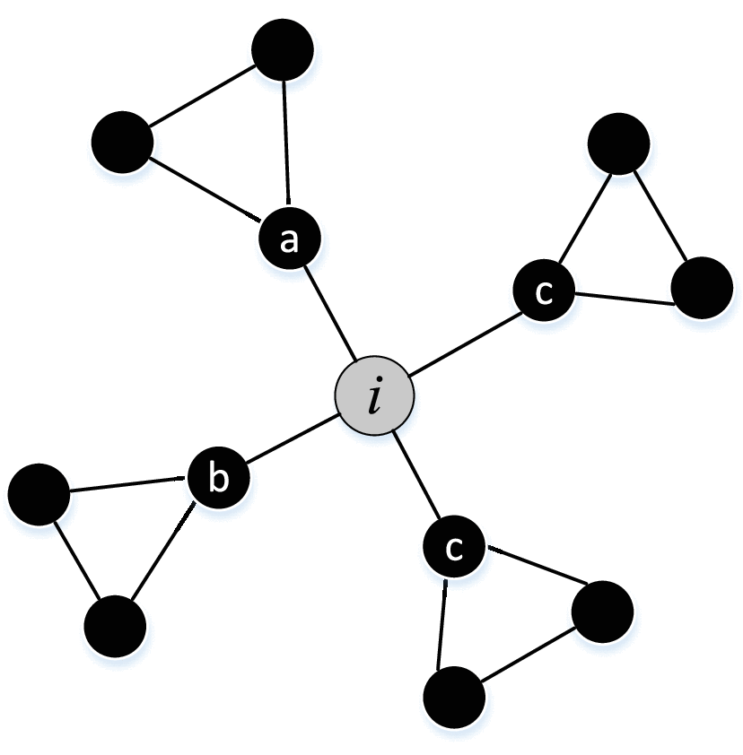
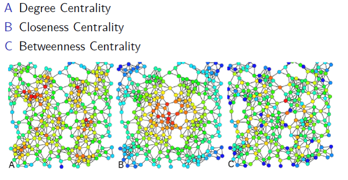
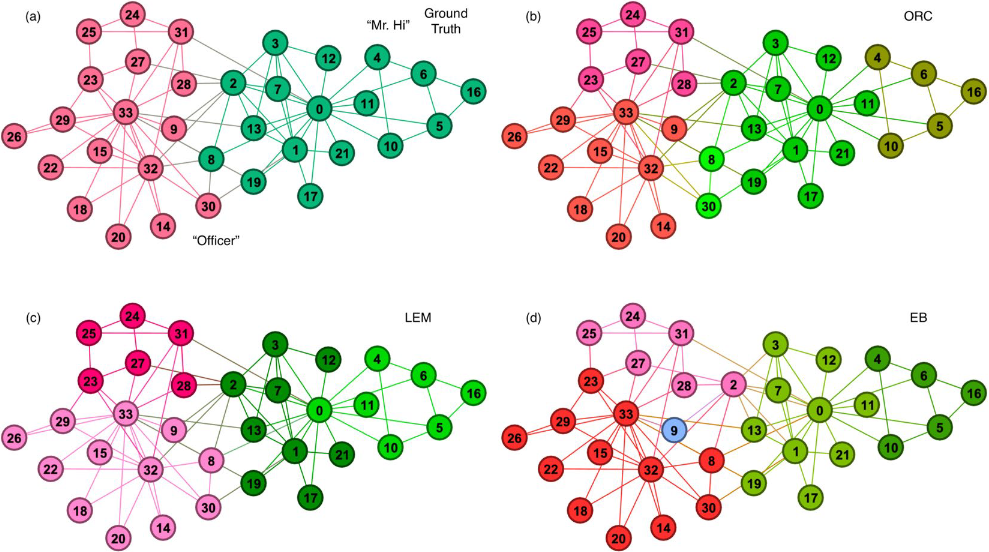
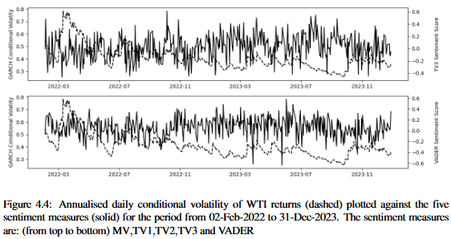
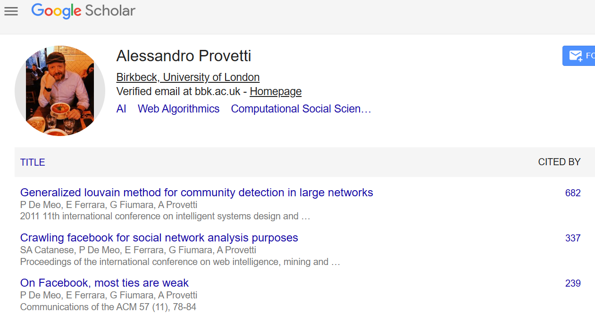
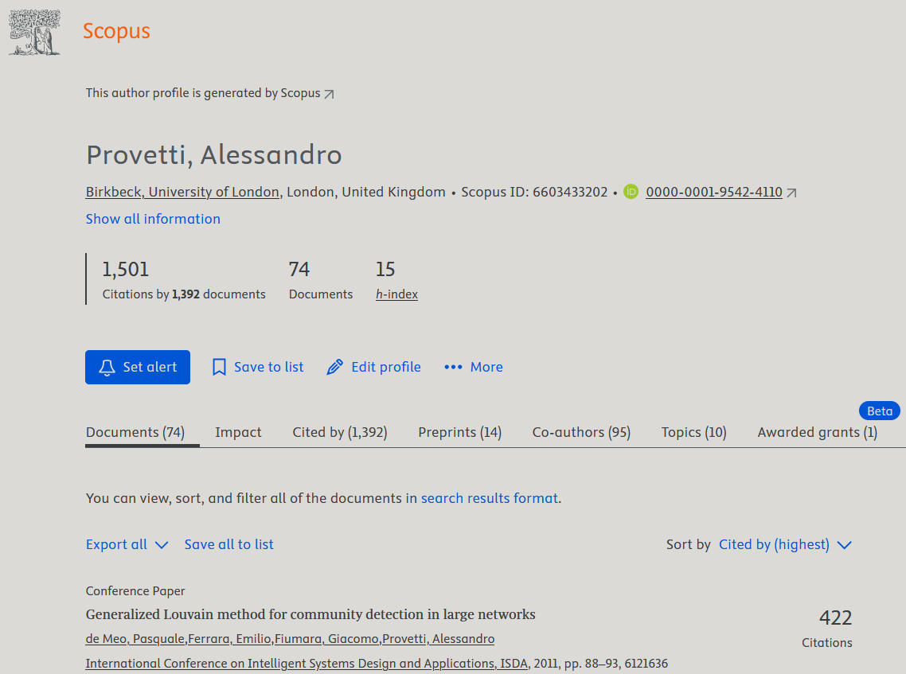
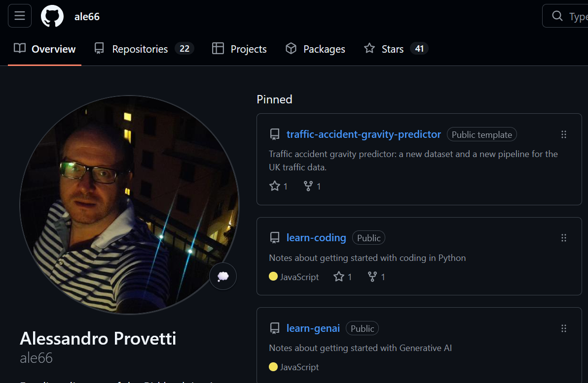

#

---

## Self-introduction

:::: {.columns}
::: {.column width="50%"}
{.cutoff}
:::
::: {.column width="50%"}
- BSc: Informatics (U. of Milan, IT)
- MEng: Information Technologies (Imperial College, UK)
- PhD: Informatics for Law (U. of Bologna + U. of Texas-El Paso, IT/US)
:::
::::

---

## Research/teaching

- La Coruna (visiting, SP)
- El Paso (US)
- Milan (IT)
- Messina (IT)
- Oxford-Man (visiting, UK)
- __Birkbeck (UK)__
- TU Wien (visiting, AT)
- __NUAA (Spring 2027, CN)__

---

## PhDs

- [Massimo Marchi](https://www.unimi.it/en/ugov/person/massimo-marchi){target="_blank" preview-link="true"} (U. of Milan, IT)
- [Alessandra Mileo](https://www.dcu.ie/computing/people/alessandra-mileo){target="_blank" preview-link="true"} (U. College Dublin, IR)
- [Emilio Ferrara](https://www.emilio.ferrara.name/){target="_blank" preview-link="true"} (U. of Southern California, US)
- [Ylli Prifti](https://www.linkedin.com/in/ylliprifti/){target="_blank" preview-link="true"} (Mitratech Corp., US)
- [Seongil Han](https://www.suwon.ac.kr/mainHp/prointro/detail.html?eno=1255128){target="_blank" preview-link="true"} (Suwon U., KR)
- [Carlo Piccari](https://www.linkedin.com/in/carlopiccari/){target="_blank" preview-link="true"} (UBS Bank, PL)

# Theme A: Models of Social Web data 

---

## Vision

The web is a network of *linked* pages

mostly automated linking, search is via Search Engine/AI Chatbots

a decentralised, emergent structure

. . .

Can links alone establish the most *important* pages, or users?

How do people find relevant content in Social Web platforms, e.g., Instagram or RedNote?

---

## A.1 Network centrality :rocket:

What is the most important page of the network?

Easy:

---

Not-so-easy :bug:

---

## A.2 detecting online communities :rocket:

Can structure alone reveal communities?

# Theme B: Sentiment Analysis & Finance 

---

## Idea:

Text of news or group discussions can summarise and reveal expectations

. . .

Examples (with [NLTK](https://text-processing.com/demo/sentiment/))

> A great win and an elegant game for AC Milan over Real Madrid

*pos: 0.81*
*neg: 0.19* 

. . .

> I love my laptop but I hate Windows 11 updates

*pos: 0.12*
*neg: 0.88* 

---

## Sentiment in Finance :rocket:

Can sentiment extracted from financial news predict markets?

---

## Find me online

:::: {.columns}

::: {.column width="33%"}
[Google Scholar](https://scholar.google.com/citations?user=pwOBPBQAAAAJ){target="_blank" preview-link="true"}

{.mini}
:::

::: {.column width="33%"}
[Scopus](https://www.scopus.com/authid/detail.uri?authorId=XXXXXXXXXXX){target="_blank" preview-link="true"}

{.mini}
:::

::: {.column width="33%"}
[GitHub](https://github.com/ale66){target="_blank" preview-link="true"}

{.mini}
:::

::::
